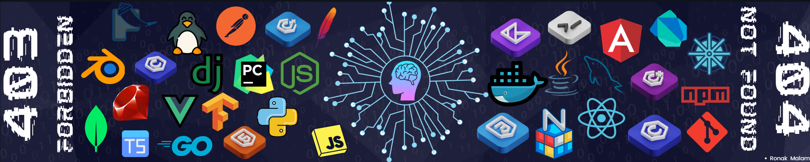

  

<h1 align="center">Hello There 👋 I’m Ronak Malam</h1>
<h3 align="center">A Progressive MERN Developer Building Innovative Solutions</h3>

  

# 📝 About Me

- 🔭 I’m currently working on **[Attendance Management System](https://github.com/Ronakmalam333/Attendance-Project)**
- 💬 Ask me about **Python, JavaScript, HTML, CSS & MERN Stack**
- 👯 I love to make new connections on **[LinkedIn](https://www.linkedin.com/in/ronak-malam/)**
- 📪 Want to reach me? **[itzronakmalam94@gmail.com](mailto:itzronakmalam94@gmail.com)**

# ✍️ Dev Quote

  

# 🌐 Socials:

  
  
  
  
  

# 💻 Tech Stack:

### 🌐 Frontend & Backend (MERN Stack)

  
  
  
  
  
  
  
  

### 💻 Programming Languages

  
  
  
  
  

### 🗄️ Databases & Cloud

  
  
  
  
  
  

### 🧠 AI, ML & Data Science

  
  
  
  
  
  

### 🛠️ Developer Tools & Engines

  
  
  
  
  
  
  
  
  
  

  

# 📊 GitHub Stats:

  
  

  

## 🔝 Featured Projects

  
  

  

## 💰 You can help me by Donating

  

<picture>
  <source media="(prefers-color-scheme: dark)" srcset="https://raw.githubusercontent.com/Ronakmalam333/Ronakmalam333/output/github-snake-dark.svg" />
  <source media="(prefers-color-scheme: light)" srcset="https://raw.githubusercontent.com/Ronakmalam333/Ronakmalam333/output/github-snake.svg" />
  
</picture>
